# tscad

**CAD as TSX.** Write parametric solid models as typed JSX components and get exact B-rep
geometry: STEP for CAD, STL and 3MF for printing, DXF for laser cutters. It's like
[tscircuit](https://tscircuit.com), but for mechanical parts. Under the hood is the
[solidcore](https://github.com/tangency-labs/solidcore) B-rep kernel, compiled to WebAssembly, so
the same model runs in bun, in the browser and in CI.

**[Docs](https://bherbruck.github.io/tscad/)** · **[Playground](https://bherbruck.github.io/tscad/play/)** ·
[Guide](docs/guide.md) · [Cookbook](docs/cookbook.md) · [API](docs/api.md) · [Examples](#gallery)

<p align="center"><a href="examples/enclosure.tsx">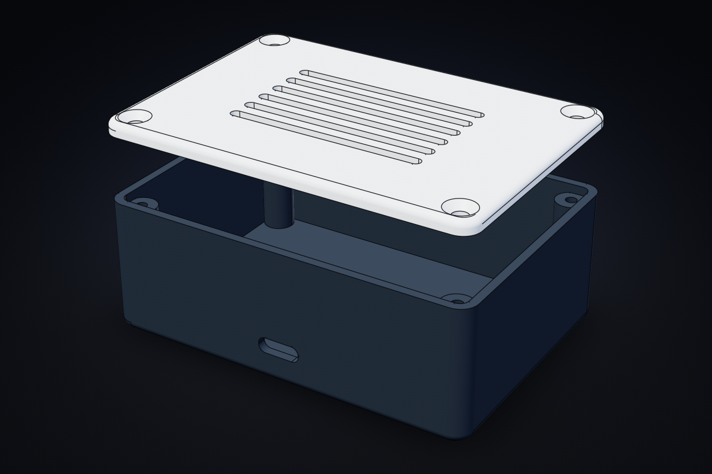</a></p>

```tsx
import { defineParams, edges, type ParamValues } from "tscad"
import { BoltPattern, CounterboreHole, mountPatterns } from "tscad/parts"

export const params = defineParams({
  thickness: { type: "number", default: 6, min: 3, max: 12, unit: "mm" },
  corner: { type: "number", default: 6, min: 0, max: 12, unit: "mm" },
})

export default function MotorMount({ thickness: t, corner }: ParamValues<typeof params>) {
  const motor = mountPatterns.nema17
  return (
    <part name="mount" material="petg">
      <difference>
        <fillet radius={corner} edges={edges.vertical()}>
          <box size={[60, 60, t]} />
        </fillet>
        <cylinder d={motor.pilot + 0.5} h={t} />
        <BoltPattern pattern={motor} z={t}>
          <CounterboreHole size="M3" depth={t} />
        </BoltPattern>
      </difference>
    </part>
  )
}
```

```sh
bunx tscad init my-part && cd my-part
bunx tscad dev --open                      # live viewer: orbit, param sliders, hot reload, click-to-selector
bunx tscad build -o part.step -o part.3mf  # exact STEP for CAD, 3MF for the slicer
```

## Why tscad

- **Exact solids, not meshes.** Real cylinders, tori and rolling-ball fillets. Meshes are made
  only at export, at the tolerance you choose, and STEP carries the exact geometry into Fusion,
  SolidWorks, FreeCAD or Onshape.
- **It's just TypeScript.** Components, props, `.map()`, conditionals, context and npm packages.
  Every element and prop is typed and documented in your editor.
- **Parametric by default.** `defineParams` gives you typed props, sliders in the viewer, flags
  on the CLI and property tests in CI. The kernel caches unchanged subtrees, so a slider only
  recomputes what it touches.
- **Errors point at your TSX.** A failing fillet is reported at the line of that `<fillet>`,
  with a code frame.
- **Built for agents.** `tscad mcp` lets Claude write, evaluate, render, check and export models.

## Features

### Sketches: holes by nesting, SVG paths, text, offsets

Draw 2D shapes inside `<extrude>`, `<revolve>`, `<loft>` or `<sweep>`. A loop inside another loop
becomes a hole. Curves stay exact (arcs and NURBS) all the way into STEP.

```tsx
<extrude height={3}>
  <offset distance={1.5}><roundedRect w={60} h={30} r={6} /></offset>   {/* a 1.5 mm margin */}
  <text size={8} align="center" valign="middle">tscad</text>            {/* letters cut through */}
  <path d="M-25 -8 h6 a3 3 0 0 1 0 6 h-6 z" />                           {/* SVG path data */}
</extrude>
```

`<rect> <roundedRect> <circle> <ellipse> <polygon> <regularPolygon> <slot> <star> <path> <text> <offset>`;
`<drawing>` makes flat parts that export to **DXF / SVG** for laser cutters and CNC.

### Constraint sketches

<a href="examples/sketch-link-arm.tsx">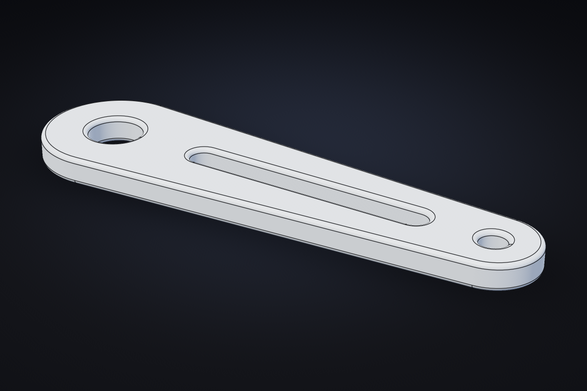</a>

Draw rough geometry, state the relations, and the solver places it exactly. It works the way
Fusion or Onshape sketches do, written as JSX. Dimensions are plain expressions, so params drive
them. Conflicts and missing constraints are reported at the TSX line.

```tsx
<extrude height={p.thickness}>
  <sketch>
    <point id="o" x={0} y={0} fixed />
    <line id="base"  from="o" to="a" horizontal length={p.width} />
    <line id="right" from="a" to="b" vertical length={p.height} />
    <arc  id="top"   from="b" to="c" tangent radius={p.width / 2} />
    <line id="left"  from="c" to="o" tangent />
    <circle center="h" diameter={p.hole} />
    <dimension a="o" b="h" dx={p.width / 2} dy={p.height} />
  </sketch>
</extrude>
```

[docs/sketch.md](docs/sketch.md) covers points, lines, arcs, splines, 17 constraint kinds and
typed refs.

<br clear="right">

### Assemblies with mates

<a href="examples/assembly-arm.tsx">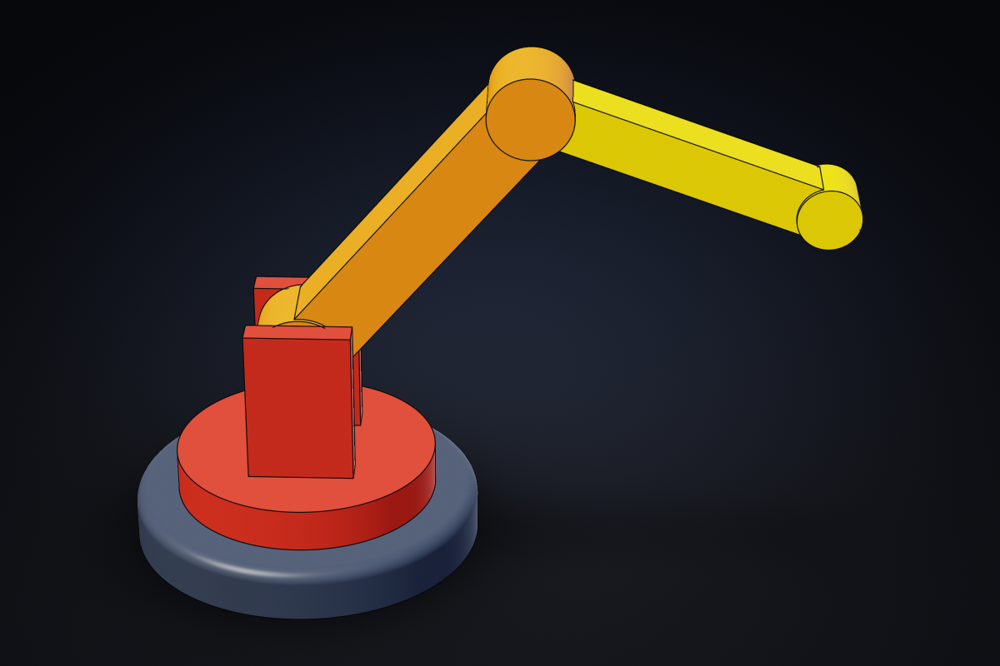</a>

Put `<anchor>`s on parts and join them with `<mate>`s. The parts move into place, so you never
compute a transform by hand. The joint types are fastened, revolute, slider, cylindrical,
planar and ball. A `<gear>` couples two joints, and param sliders pose the mechanism.

```tsx
<assembly>
  <Base />
  <UpperArm />
  <mate a="base.shoulder" b="upper.root" type="revolute" angle={p.shoulder} />
</assembly>
```

See [docs/assembly.md](docs/assembly.md).

<br clear="right">

### Features and selectors

`<fillet>` `<chamfer>` `<shell>` `<draft>` `<pushPull>` `<split>`, plus booleans, patterns
(`linear`, `grid`, `polar`) and `<mirror keep>`. Edges and faces are picked by what they *are*,
so selectors survive param changes. In the viewer, click an edge to get its selector.

```tsx
<fillet radius={2} edges="<Z">                    {/* CadQuery-style string… */}
  <shell thickness={2} open={faces.top()}>        {/* …or a builder */}
    <draft angle={3}><box size={[60, 40, 25]} /></draft>
  </shell>
</fillet>
```

### Parts library: `tscad/parts`

<a href="examples/parts-showcase.tsx">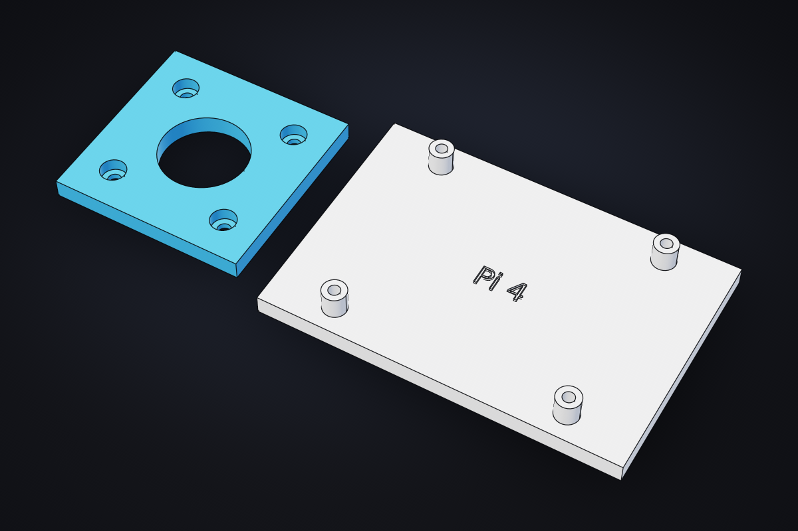</a>

Parts are just components. The library has ISO metric holes (clearance, counterbore,
countersink, tap), nut traps, heat-set insert pockets, standoffs, published mounting patterns
(Raspberry Pi 4 and Zero, Arduino Uno, NEMA 17/23) and 2020 extrusion. It also exports the
`metric` table (`metric.M3.clearance.normal` → 3.4).

Board models do the measuring for you. `boards.raspberryPi5` (also Pi 4, Zero 2 W, Pico,
Arduino Uno and ESP32-DevKitC) holds every connector as data. `<BoardCase board={boards.raspberryPi5} />`
generates the whole enclosure: standoffs, port openings, a vented lid, and the board mated
inside it so an interference check proves the fit. See
[examples/pi5-case-auto.tsx](examples/pi5-case-auto.tsx).

It has laser-cut generators too. `<FingerJointBox>` produces finger-jointed panels with kerf
compensation and engraved labels, on separate CUT and ENGRAVE DXF layers. It can also show the
box folded up, so you can check the joints with interference. `<LivingHinge>` makes bendable
sheet. See [examples/laser-box.tsx](examples/laser-box.tsx).

<br clear="right">

### Checks and model tests

```ts
import { evaluateModel, paramCombos } from "tscad/testing"
import * as bracket from "./bracket"

test.each(paramCombos(bracket.params, { samples: 4 }))("bracket %o", async (p) => {
  const r = await evaluateModel(bracket, p)
  expect(r).toEvaluate()
  expect(r).toBePrintable({ minWall: 0.8, bed: [220, 220, 250] })   // overhangs, thin walls, bed fit
  await expect(r).toHaveNoInterference()
})
```

`tscad/check` finds overhangs (as a per-triangle heatmap), measures wall thickness with BVH ray
casts, finds interference between parts and checks meshes are watertight. See
[docs/checks.md](docs/checks.md).

### Design with Claude

```sh
claude mcp add tscad -- bunx tscad mcp
```

The MCP server gives agents the element reference, which is generated from the types, plus
tools to evaluate, render (PNG), check (overhangs, walls, interference), pick selectors and
export. Ask for "a NEMA 17 mount plate with counterbored M3 holes, exported to STEP" and it
iterates until the model builds clean. See [docs/mcp.md](docs/mcp.md).

### Export and render

| Format | What you get |
|---|---|
| **STEP** (AP242) | exact B-rep, for CAD, CAM and manufacturing |
| **STL** | binary or ASCII, all parts in one file |
| **3MF** | one closed mesh per part, with colours, in mm, ready for slicers |
| **GLB** | glTF 2.0, one mesh per part with PBR colour, Y-up, in metres |
| **OBJ** | one `o` group per part, with normals |
| **DXF / SVG** | `<drawing>` parts, with real arcs, or a section of a solid |

```ts
import { renderModule } from "tscad"
import { loadKernel } from "tscad/kernel"
import { exportModel } from "tscad/export"
import { renderPNG } from "tscad/render"

const { document } = renderModule(await import("./plate.tsx"), { holes: 6 })
const kernel = await loadKernel()
await kernel.evaluate(document)
const parts = document.parts!.map((p) => ({ name: p.name!, color: p.color }))
await Bun.write("plate.step", await exportModel(kernel, parts, "step"))
const meshes = await Promise.all(parts.map(async (p) => ({ ...p, mesh: await kernel.meshAt(p.name, 0.02) })))
await Bun.write("plate.png", renderPNG(meshes, { view: "iso", background: "dark" }))
```

`tscad/render` is a software renderer in pure TypeScript, with no GPU or DOM needed. It gives
you studio lighting, a soft shadow, crisp B-rep edges and supersampling. It made every image
in this README.

### Playground and viewer

The [playground](https://bherbruck.github.io/tscad/play/) runs the editor, the kernel and the
viewer entirely in your browser, and share links carry the source. `tscad dev` gives you the
same viewer locally, with hot reload, param sliders, section and measure tools, sketch
overlays, and pick-to-selector.

## Gallery

<table>
<tr>
<td width="33%" valign="top"><a href="examples/spur-gear.tsx"></a><br><b>Spur gear</b>: true involute flanks, filleted roots</td>
<td width="33%" valign="top"><a href="examples/bracket.tsx">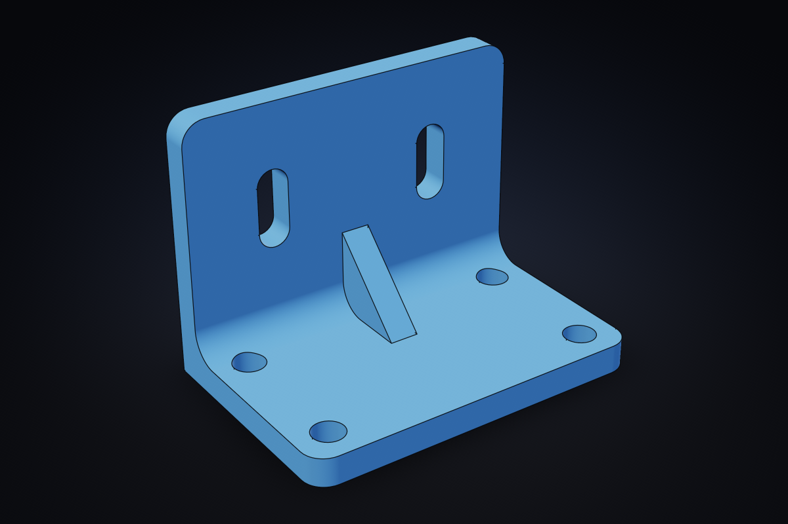</a><br><b>Bracket</b>: combined selectors, gusset, hole grid</td>
<td width="33%" valign="top"><a href="examples/vase.tsx">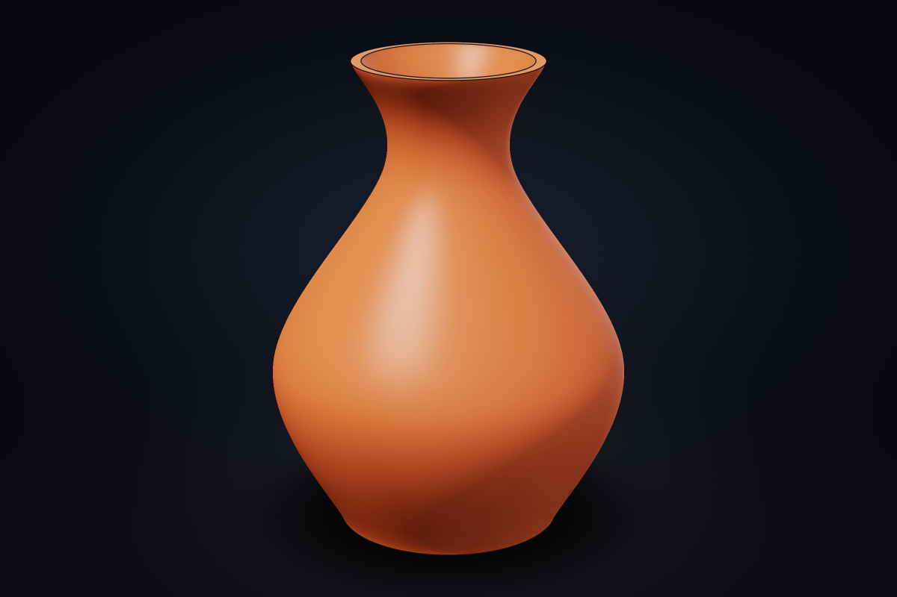</a><br><b>Vase</b>: SVG-path silhouette, revolve, shell</td>
</tr>
<tr>
<td valign="top"><a href="examples/bolt-and-nut.tsx"></a><br><b>Bolt and nut</b>: ISO table as a choice param</td>
<td valign="top"><a href="examples/assembly-hinge-box.tsx">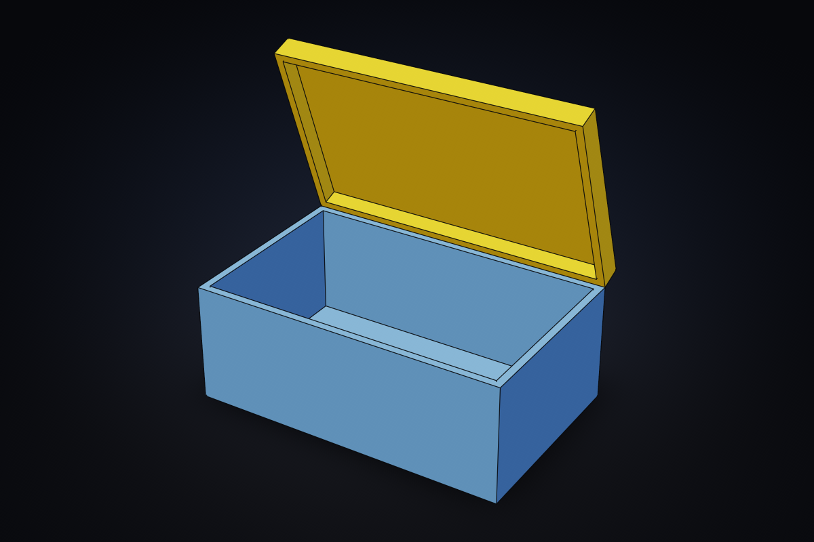</a><br><b>Hinged box</b>: a revolute mate driven by a param</td>
<td valign="top"><a href="examples/sketch-pulley.tsx">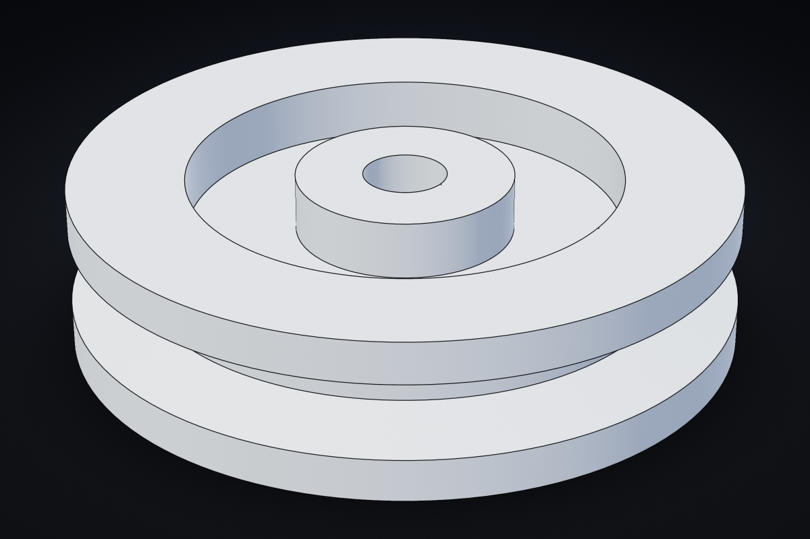</a><br><b>V-belt pulley</b>: a constrained half section, revolved</td>
</tr>
<tr>
<td valign="top"><a href="examples/coaster.tsx">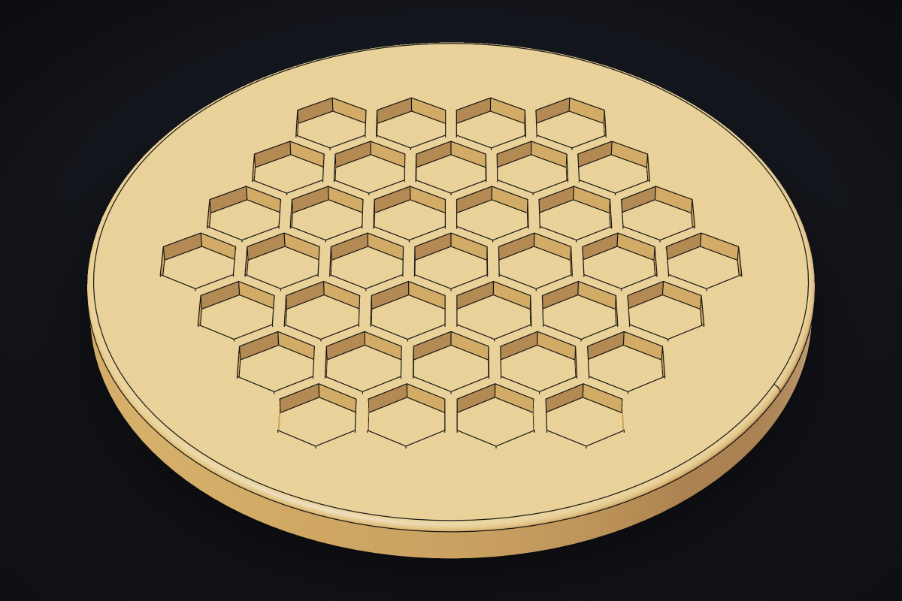</a><br><b>Coaster</b>: honeycomb as one sketch</td>
<td valign="top"><a href="examples/phone-stand.tsx">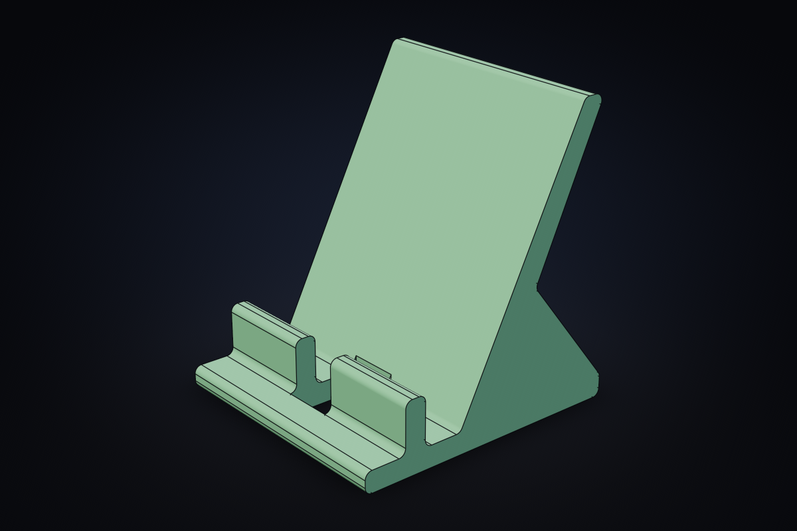</a><br><b>Phone stand</b>: angle-driven profile</td>
<td valign="top"><a href="examples/laser-box.tsx">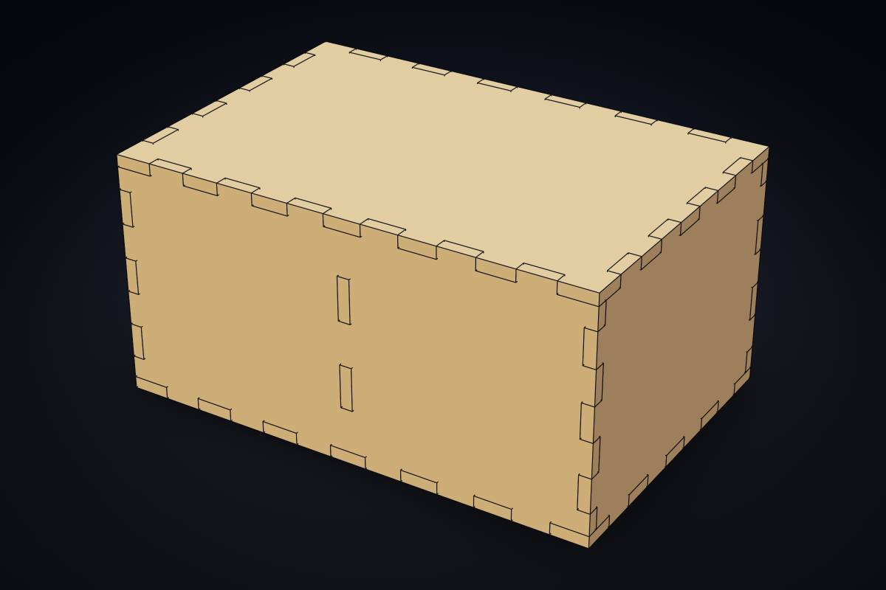</a><br><b>Laser-cut box</b>: finger joints, exported to DXF</td>
</tr>
</table>

Open any of them in the [playground](https://bherbruck.github.io/tscad/play/#example=enclosure),
or run `bunx tscad dev examples/<name>.tsx` from a checkout.

## Packages

One npm package, `tscad`, with subpath exports. The full API is in [docs/api.md](docs/api.md).

| Import | What |
|---|---|
| `tscad` | elements' types, `defineParams`, `edges`/`faces`, `compile`, `renderModule`, paths (`helix`...), units, materials, sketch and assembly refs |
| `tscad/parts` | the component library |
| `tscad/kernel` | `loadKernel()`: evaluate, mesh, STEP, pick |
| `tscad/export` | STL, 3MF, GLB, OBJ, STEP |
| `tscad/render` | headless PNG renderer (pure TypeScript) |
| `tscad/drawing` | DXF and SVG, mesh sections |
| `tscad/check` | printability, interference, watertightness |
| `tscad/testing` | `bun:test` matchers and param sweeps |
| `tscad/mcp` | the MCP server |
| `tscad/ir` | IR types |

## CLI

| Command | |
|---|---|
| `tscad init [dir]` | scaffold `index.tsx`, `package.json`, `tsconfig.json` |
| `tscad dev [file]` | live viewer with hot reload (`--open`, `--port`) |
| `tscad build [file] -o out.step` | `step` `stl` `3mf` `glb` `obj` `dxf` `svg`; `-p key=value`, `-t <mm>`, `--part`, `--json` |
| `tscad info [file]` | params, volume, mass and bounds per part |
| `tscad render [file] -o out.png` | `--view iso\|front\|top\|…`, `--width`, `--background`, `--ortho` |
| `tscad mcp` | MCP server over stdio |

## Status

tscad is **v0.1**, so expect rough edges. These are the known limits, most of them in the
kernel; [docs/KERNEL_ISSUES.md](docs/KERNEL_ISSUES.md) has repros and
[docs/FUZZ.md](docs/FUZZ.md) has fuzzing results.

- **Speed.** A boolean takes on the order of a second on the first build (the examples take
  roughly 1–8 s); after that the subtree cache keeps parameter tweaks quick. Prefer one cut
  with many shapes over many separate cuts.
- **Sweeps** along a `helix()` don't produce a closed solid yet, and polyline paths with sharp
  corners fail, so threads are cosmetic for now.
- **Shell** fails inward across tangent walls, such as an extruded `roundedRect`. Use `outward`
  or a `<difference>`.
- **Tori** that are rotated, or used in booleans, can give wrong results. The kernel fuzzer
  found these; see [docs/FUZZ.md](docs/FUZZ.md).
- **STEP import** (`<step>`) reads analytic models; files with blended corners fail.
- **Fillets** need radii the neighbouring faces allow, and filleting hundreds of edges is slow.

## Credits and license

Geometry by [solidcore](https://github.com/tangency-labs/solidcore) (Apache-2.0), a Rust B-rep
kernel. The component model is inspired by [tscircuit](https://tscircuit.com). Text uses
DejaVu Sans ([Bitstream Vera license](assets/fonts/LICENSE-DejaVu.txt)).

Licensed under either [MIT](LICENSE-MIT) or [Apache-2.0](LICENSE-APACHE), at your option.
