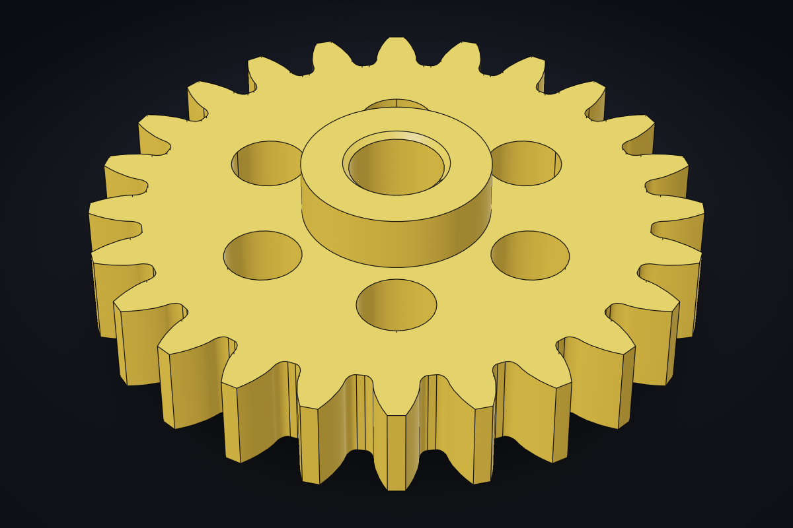
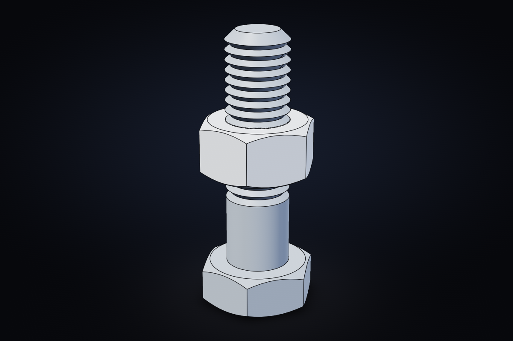
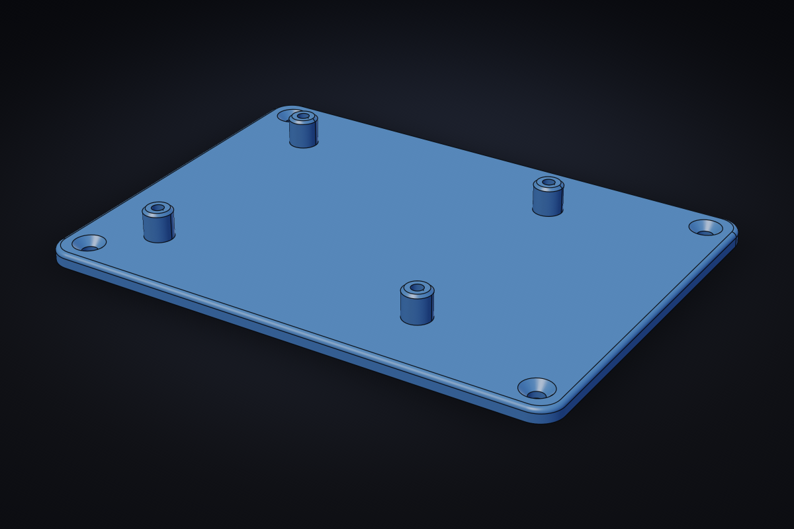

# tscad

**CAD as TSX.** Write parametric 3D solids as React-style components, get exact B-rep geometry,
export STEP, STL, 3MF, GLB and OBJ. Like [tscircuit](https://tscircuit.com), but for mechanical
parts — powered by the [solidcore](https://github.com/tangency-labs/solidcore) B-rep kernel,
compiled to WebAssembly so it runs in bun and in the browser.

<p align="center"><a href="examples/enclosure.tsx"></a></p>

```tsx
import { defineParams, edges, type ParamValues } from "tscad"

export const params = defineParams({
  length: { type: "number", default: 80, min: 30, max: 200, unit: "mm" },
  holes: { type: "int", default: 4, min: 1, max: 10 },
  radius: { type: "number", default: 4, min: 0, max: 8, unit: "mm" },
})

export default function Plate({ length, holes, radius }: ParamValues<typeof params>) {
  const pitch = (length - 20) / Math.max(1, holes - 1)
  return (
    <part name="plate" material="aluminum">
      <difference>
        <fillet radius={radius} edges={edges.vertical()}>
          <box size={[length, 30, 12]} />
        </fillet>
        <linearPattern count={holes} dx={pitch} x={-length / 2 + 10}>
          <cylinder d={5.5} h={12} />
        </linearPattern>
      </difference>
    </part>
  )
}
```

```sh
tscad dev plate.tsx                       # live viewer: orbit, sliders for every param, hot reload
tscad build plate.tsx -o plate.step       # exact B-rep for your CAD tool
tscad build plate.tsx -o plate.3mf -p holes=6   # ...or a mesh for your slicer
```

## Why tscad

- **Exact solids, not meshes.** Every model is a boundary representation: real cylinders, real
  tori, real fillets that roll along edges. Meshes are made only at the end, at whatever
  tolerance you ask for, and **STEP export** carries the exact geometry into Fusion, SolidWorks,
  FreeCAD or Onshape.
- **The React mental model.** Components, props, `.map()`, conditionals, context, fragments. A
  screw boss is a function; a hole pattern is an array. No new language to learn, full
  TypeScript types and editor autocomplete.
- **Parametric by default.** `defineParams` declares typed parameters (number, int, boolean,
  choice) that become sliders and toggles in the viewer and flags on the CLI.
- **Fast iteration.** The kernel caches every subtree by structure, so moving one slider only
  recomputes the branch it touches.
- **Runs anywhere JavaScript does.** The kernel is Rust compiled to WebAssembly. The same code
  evaluates in bun, in a Web Worker in the browser, and in CI.
- **Errors point at your TSX.** Every IR node remembers the JSX element that made it, so a
  failing fillet is reported at the line of that `<fillet>`, not as an opaque kernel stack.

## Quickstart

```sh
bunx tscad init my-part     # scaffold index.tsx, package.json and tsconfig.json
cd my-part
bunx tscad dev              # open the viewer on index.tsx
bunx tscad build -o part.step -o part.stl
bunx tscad info             # params, volume, mass, bounding box of each part
```

To add tscad to an existing bun project: `bun add tscad`, then set
`"jsx": "react-jsx", "jsxImportSource": "tscad"` in `tsconfig.json`.

`tscad build` options: `-o file` (repeatable; the extension picks the format), `-p key=value`
(override a param), `-t 0.05` (mesh tolerance, mm), `--part name`, `--ascii` (ASCII STL), `--json`.

## Examples

<table>
<tr>
<td width="50%" valign="top"><a href="examples/enclosure.tsx"></a><br><b><a href="examples/enclosure.tsx">Enclosure</a></b> — `<assembly>` of body + lid, a `<Boss>` component, vent louvres, revolved countersinks, filleted edges</td>
<td width="50%" valign="top"><a href="examples/spur-gear.tsx"></a><br><b><a href="examples/spur-gear.tsx">Spur gear</a></b> — true involute flanks as Bézier `path` data with root fillets, `polarPattern` lightening holes, bore chamfer by `edges.radius()`</td>
</tr>
<tr>
<td width="50%" valign="top"><a href="examples/bracket.tsx"></a><br><b><a href="examples/bracket.tsx">Bracket</a></b> — rounded corners and an inside-bend fillet picked with combined selectors, gusset sketch, `gridPattern` holes, slots</td>
<td width="50%" valign="top"><a href="examples/vase.tsx"></a><br><b><a href="examples/vase.tsx">Vase</a></b> — smooth silhouette from an SVG `path`, `revolve`, `shell`, a `choice` param for the glaze</td>
</tr>
<tr>
<td width="50%" valign="top"><a href="examples/bolt-and-nut.tsx"></a><br><b><a href="examples/bolt-and-nut.tsx">Bolt and nut</a></b> — ISO metric table as a `choice` param, chamfered hex via `intersection`, the whole grooved shank as one `revolve`</td>
<td width="50%" valign="top"><a href="examples/coaster.tsx"></a><br><b><a href="examples/coaster.tsx">Coaster</a></b> — honeycomb laid out with plain loops, filtered to the rim and cut as one sketch</td>
</tr>
<tr>
<td width="50%" valign="top"><a href="examples/phone-stand.tsx"></a><br><b><a href="examples/phone-stand.tsx">Phone stand</a></b> — angle-driven side profile as a `polygon` on the XZ plane, extruded and filleted</td>
<td width="50%" valign="top"><a href="examples/component-library.tsx"></a><br><b><a href="examples/component-library.tsx">Component library</a></b> — reusable typed components (`<Standoff/>`, `<CountersunkHole/>`, `<RoundedPlate/>`) and a board table</td>
</tr>
<tr>
<td width="50%" valign="top"><a href="examples/parts-showcase.tsx"></a><br><b><a href="examples/parts-showcase.tsx">Parts library</a></b> — the `tscad/parts` components: a NEMA 17 mount with counterbores and a Raspberry Pi base with an engraved label</td>
<td width="50%" valign="top"><a href="examples/sketch-link-arm.tsx"></a><br><b><a href="examples/sketch-link-arm.tsx">Link arm</a></b> — a constraint sketch: tangent lines between two bosses solved for you, every dimension a param</td>
</tr>
<tr>
<td width="50%" valign="top"><a href="examples/sketch-pulley.tsx"></a><br><b><a href="examples/sketch-pulley.tsx">V-belt pulley</a></b> — a constraint-sketched half section kept symmetric by constraints, revolved about Z</td>
</tr>
</table>

Run one from a checkout with `bun src/cli/index.ts dev examples/spur-gear.tsx`. The images are rendered
headlessly by `tscad/render` (`bun scripts/render-examples.ts`).

## Elements

All lengths are millimetres, all angles degrees, Z is up. Every solid element accepts the
placement props `x y z at rotate rotateX rotateY rotateZ scale mirror` (applied as mirror,
scale, rotate, then translate).

| Element | Props | Notes |
|---|---|---|
| `<part>` | `name color material density visible` | one named solid — the unit of export; `material` (`"pla"`, `"aluminum"`, `"steel"`, …) sets a default colour and density |
| `<assembly>` | `name` | groups parts (and nests) |
| `<group>` | | unions children so they can be placed together |
| `<box>` | `size` or `w d h`, `center` | **centred in X and Y, base on z = 0** by default |
| `<cylinder>` | `r`/`d`, `h`, `center` | about +Z, base on z = 0 |
| `<cone>` | `r1 r2` (or `d1 d2`), `h` | frustum about +Z; `r2={0}` for a point |
| `<sphere>` | `r`/`d` | centred |
| `<torus>` | `R r` | about +Z, centred |
| `<union>` `<difference>` `<intersection>` | | `difference` subtracts every later child from the first (aliases `subtract`, `intersect`) |
| `<translate>` `<rotate>` `<scale>` `<mirror>` | `x y z` / `by axis angle origin` / `by` / `axis keep origin` | explicit transforms; `<mirror keep>` makes a symmetric pair |
| `<extrude>` | `height draft plane offset center` | 2D children → solid; `plane="XY"\|"XZ"\|"YZ"` |
| `<revolve>` | `angle` | about Z: sketch x is the radius, sketch y the height |
| `<loft>` | `ruled` | through 2D sections, each with a `z` (or in `<section z>`) |
| `<sweep>` | `path frame` | a profile along a 3D path (`polyline3`, `arc3`, `bezier3`, `helix`) |
| `<fillet>` | `radius edges` | rounds the selected edges of its children |
| `<chamfer>` | `distance edges` | bevels the selected edges |
| `<shell>` | `thickness open outward` | hollows the children; `open` faces are removed |
| `<linearPattern>` | `count step` (or `dx dy dz`), `center` | `count` copies, each offset by `step` |
| `<gridPattern>` | `nx ny dx dy center` | an XY grid (centred by default) |
| `<polarPattern>` | `count angle axis radius startAngle` | copies around an axis |

**2D sketch shapes** (children of `extrude`, `revolve`, `loft`, `sweep`): `<rect w h>`,
`<roundedRect w h r>`, `<circle r>`, `<ellipse rx ry>`, `<polygon points>`,
`<regularPolygon sides r|apothem|flats>`, `<slot length width>`, `<star points r1 r2>`,
`<path d="M … Z">` and `<sketch>` to group them. Shapes are centred and take `x y at rotate mirror`.
Loops nested inside other loops become **holes**. `path` takes SVG path data
(`M L H V C S Q T A Z`): Béziers become exact NURBS and arcs exact arcs, so curved sketches stay
curved all the way into STEP.

Helpers: `inch() mm() cm() deg() rad() range() linspace()`, `helix() polyline3() arc3() bezier3()`,
`materials`, `massOf()`. Components can use `createContext`/`useContext` and fragments.

## Selectors

Fillets, chamfers and shells take a selector for the edges or faces they act on: a chainable
builder, a CadQuery-style string, or a raw IR selector. Each chained call narrows the selection.

| Builder | String | Selects |
|---|---|---|
| `edges.all()` | `"*"` | everything |
| `edges.top()` = `edges.max("z")` | `">Z"` | lying wholly at the top of the body |
| `edges.bottom()` = `edges.min("z")` | `"<Z"` | at the bottom |
| `edges.vertical()` = `edges.parallel("z")` | `"\|Z"` | straight edges along Z (faces: normal ±Z) |
| `edges.circles()` = `edges.perpendicular("z")` | `"#Z"` | circles about Z |
| `edges.radius(3)` | | circles of radius 3 |
| `edges.within([x0,y0,z0], [x1,y1,z1])` | | inside a box |
| `a.and(b)` `a.or(b)` `a.not()` | `and or not ( )` | combine: `">Z or \|Z"` |

`faces` has the same builders: `<shell thickness={2} open={faces.top()}>`. In the viewer, click an
edge or face to see the selectors that name it and how many items each one matches.

## Export formats

| Format | What you get |
|---|---|
| **STEP** (AP242) | exact B-rep — for CAD, CAM and manufacturing |
| **STL** | binary (or ASCII), all parts in one file |
| **3MF** | one closed mesh object per part, with colours and millimetre units — ready for slicers |
| **GLB** | glTF 2.0, one mesh per part with PBR colour, Y-up, metres — for the web, Blender, AR |
| **OBJ** | one `o` group per part with normals |

From code:

```ts
import { renderModule } from "tscad"
import { loadKernel } from "tscad/kernel"
import { exportModel } from "tscad/export"

const { document } = renderModule(await import("./plate.tsx"), { holes: 6 })
const kernel = await loadKernel()
await kernel.evaluate(document)
const parts = document.parts!.map((p) => ({ name: p.name!, color: p.color }))
await Bun.write("plate.step", await exportModel(kernel, parts, "step"))
await Bun.write("plate.3mf", await exportModel(kernel, parts, "3mf", { tolerance: 0.01 }))
```

### Rendering images

`tscad/render` is a software renderer in pure TypeScript (no GPU, no DOM; fflate for the PNG): studio
lighting, soft ground shadow, crisp B-rep edge lines, supersampled. It makes product shots like
the gallery above, in bun or in the browser:

```ts
import { renderPNG } from "tscad/render"

const meshes = await Promise.all(parts.map(async (p) => ({ ...p, mesh: await kernel.meshAt(p.name, 0.02) })))
await Bun.write("plate.png", renderPNG(meshes, { width: 1200, height: 800, view: "iso", background: "dark" }))
```

Options: `view` (`"iso" | "front" | "top" | "right" | …` or `{ azimuth, elevation }`),
`background` (`"dark" | "light" | "transparent"` or a CSS colour), `edges`, `smoothEdges`,
`shadow`, `ssaa`, `projection` (`"perspective" | "orthographic"`).

## How it works

```
 part.tsx ──► JSX runtime ──► element tree ──► compile() ──► IR (cad-json) ──► solidcore (wasm)
 (params)    tscad/jsx-runtime   components       tscad          tscad/ir           tscad/kernel
                                  run here                                             │
                       ┌───────────────────────────────────────────────────────────────┤
                       ▼                              ▼                                ▼
               viewer (three.js)            export: STL 3MF GLB OBJ               STEP (exact)
```

1. Your component runs like a React function component, but once, at compile time, producing a
   tree of plain elements.
2. `compile()` turns the tree into a small JSON IR: primitives, booleans, transforms, sketches as
   exact curves, features with selectors. Every IR node remembers its TSX source line.
3. The solidcore kernel evaluates the IR into B-rep solids, caching subtrees by structure.
4. The viewer draws the kernel's meshes and edges; exporters write files; STEP comes straight from
   the B-rep.

Packages (one npm package, subpath exports): `tscad`, `tscad/jsx-runtime`, `tscad/kernel`,
`tscad/export`, `tscad/render`, `tscad/ir`.

See [docs/guide.md](docs/guide.md) for a full tutorial and [docs/ARCHITECTURE.md](docs/ARCHITECTURE.md)
for the internals.

## Status

tscad is young (v0.1). Known gaps, mostly in the kernel (details and repros in
[docs/KERNEL_ISSUES.md](docs/KERNEL_ISSUES.md)):

- **Speed.** Booleans cost around a second each on the first build (the bundled examples take
  roughly 1–8 s); after that the subtree cache makes most parameter changes much faster. Prefer
  one cut with many shapes (holes in a sketch, or one `<extrude>` of many slots) over many
  separate cuts.
- **Shell** fails inward across tangent walls (e.g. an extruded `roundedRect`); use `outward`, or
  build the cavity with a `<difference>`. Shelling boxes, cylinders and revolved profiles works.
- **Sweep** along a `helix()` doesn't produce a closed solid yet, and polyline paths with sharp
  corners fail — threads are cosmetic for now.
- **STEP import** of models with blended corners isn't supported (export is fine).

## Credits

tscad's geometry is [solidcore](https://github.com/tangency-labs/solidcore) (Apache-2.0), a Rust
B-rep kernel based on NVIDIA's SMLib from `usd-brep`. The component model is inspired by
[tscircuit](https://tscircuit.com).

## License

Licensed under either of [MIT](LICENSE-MIT) or [Apache-2.0](LICENSE-APACHE), at your option.
