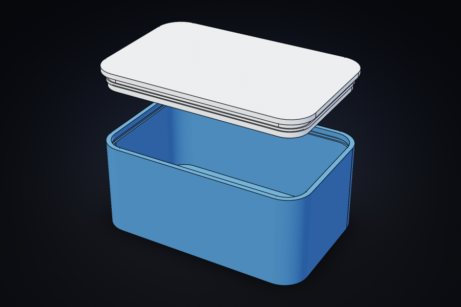
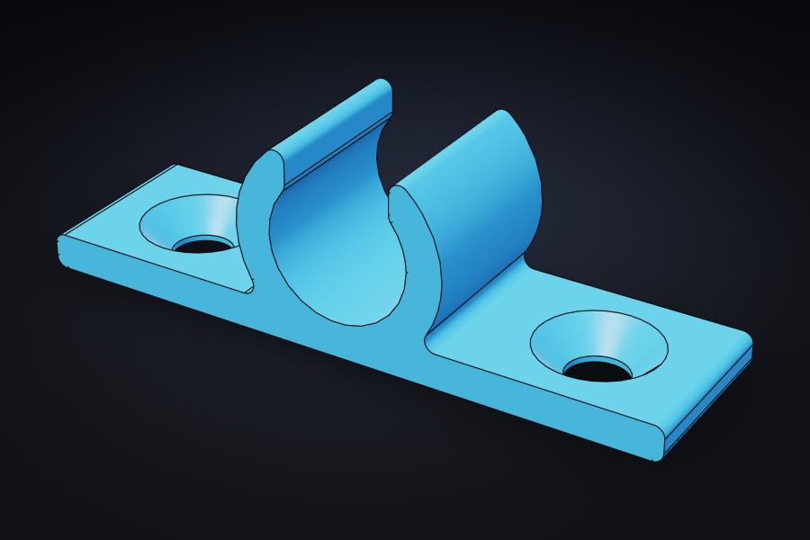
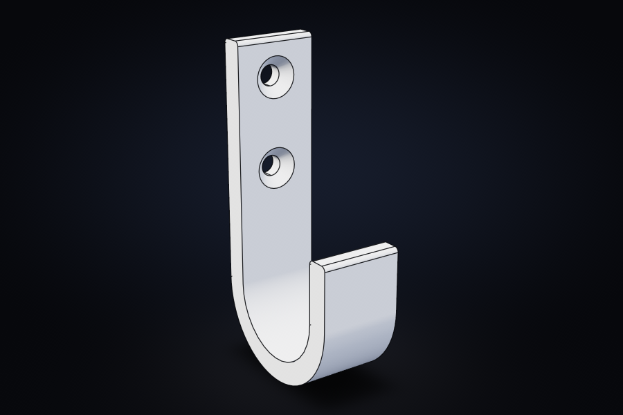
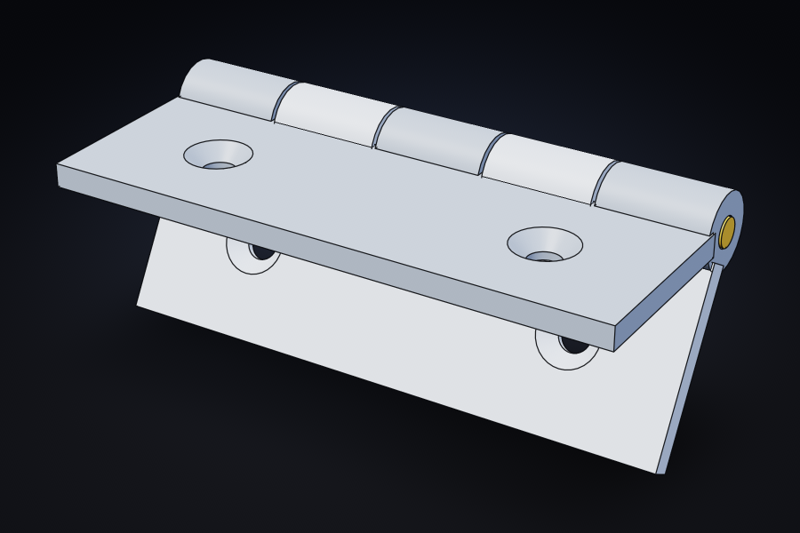
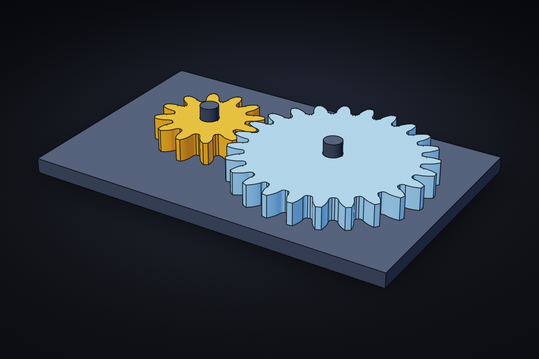
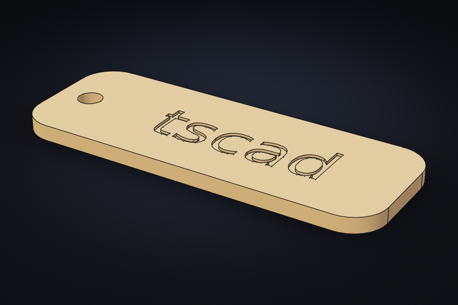
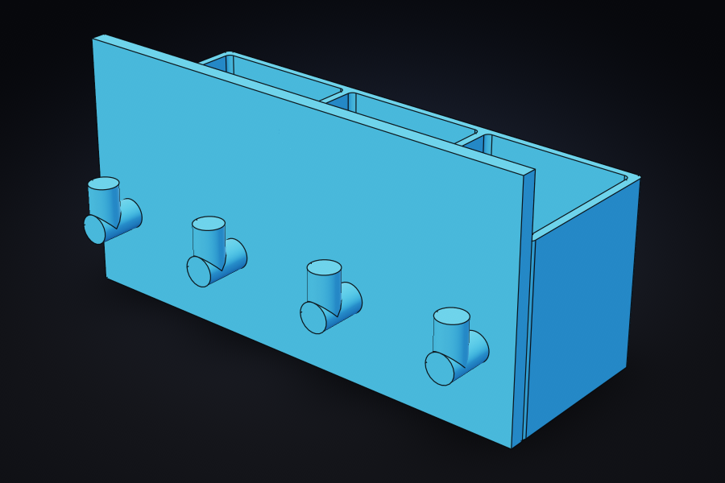
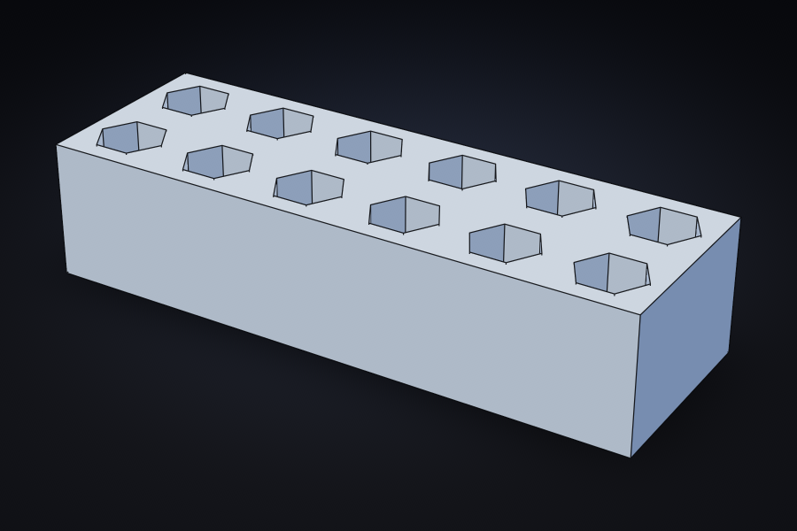
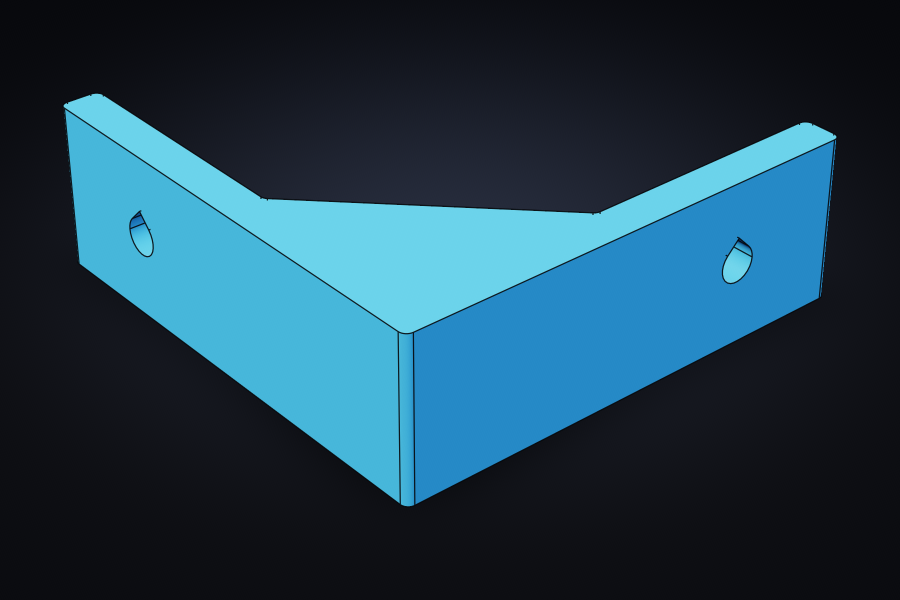

# Cookbook

Short, complete recipes. Each one is a runnable model in the repository: open it in `tscad dev`, change the params, and build it. They're also good starting points to copy from.

- [Rounded box with a snap-fit lid](#rounded-box-with-a-snap-fit-lid)
- [Cable clip](#cable-clip)
- [Wall hook](#wall-hook)
- [Pin hinge with joint limits](#pin-hinge-with-joint-limits)
- [Gear pair with a <gear> coupling](#gear-pair-with-a-coupling)
- [Engraved name tag (laser → DXF)](#engraved-name-tag-laser-dxf)
- [Pegboard bins](#pegboard-bins)
- [Hex-bit holder, converted from OpenSCAD](#hex-bit-holder-converted-from-openscad)
- [A bracket that proves it prints without supports](#a-bracket-that-proves-it-prints-without-supports)

## Rounded box with a snap-fit lid

Snap-fit box: a rounded tub and a lid whose lip carries a snap bead that clicks into a groove inside the rim. The lid is placed by a fastened mate (lid seated on the rim); set `exploded` to lift it off. Clearances come from `<offset>` on one shared outline.

<p></p>

```tsx
/**
 * Snap-fit box: a rounded tub and a lid whose lip carries a snap bead that clicks into a groove
 * inside the rim. The lid is placed by a fastened mate (lid seated on the rim); set `exploded`
 * to lift it off. Clearances come from `<offset>` on one shared outline.
 */
import { assemblyRefs, defineParams, faces, type ParamValues } from "tscad"

export const params = defineParams({
  width: { type: "number", default: 70, min: 30, max: 160, step: 1, unit: "mm", label: "Width" },
  depth: { type: "number", default: 45, min: 25, max: 120, step: 1, unit: "mm", label: "Depth" },
  height: { type: "number", default: 30, min: 12, max: 100, step: 1, unit: "mm", label: "Height" },
  radius: { type: "number", default: 8, min: 2, max: 20, step: 0.5, unit: "mm", label: "Corner radius" },
  clearance: { type: "number", default: 0.2, min: 0, max: 0.6, step: 0.05, unit: "mm", label: "Fit clearance" },
  exploded: { type: "boolean", default: true, label: "Exploded" },
})

const WALL = 1.6
const LIP = 5 // lip depth into the tub
const BEAD = 0.6 // snap bead / groove size

const A = assemblyRefs<{ tub: "rim"; lid: "seat" }>()

export default function SnapBox(p: ParamValues<typeof params>) {
  const outline = (grow = 0) => <offset distance={grow}><roundedRect w={p.width} h={p.depth} r={p.radius} /></offset>
  const inner = -WALL // the tub's inside wall
  const lip = inner - p.clearance // the lid lip's outside
  return (
    <assembly>
      <part name={A.tub.name} color="#4f7cac" fixed>
        <difference>
          <extrude height={p.height}>{outline()}</extrude>
          {/* cavity (open top), floor 1.6 mm */}
          <extrude height={p.height} offset={WALL}>{outline(inner)}</extrude>
          {/* snap groove just below the rim */}
          <extrude height={BEAD * 2} offset={p.height - LIP / 2 - BEAD}>
            {outline(inner + BEAD)}
          </extrude>
        </difference>
        <anchor id="rim" at={[0, 0, p.height]} />
      </part>
      <part name={A.lid.name} color="#e9edf3">
        {/* top plate */}
        <extrude height={WALL}>{outline()}</extrude>
        {/* lip: a ring hanging down into the tub, with a bead that lands in the groove */}
        <extrude height={-LIP}>
          {outline(lip)}
          {outline(lip - 1.2)}
        </extrude>
        <extrude height={BEAD * 1.6} offset={-LIP / 2 - BEAD * 0.8}>
          {outline(lip + BEAD - p.clearance)}
          {outline(lip - 0.6)}
        </extrude>
        <anchor id="seat" at={[0, 0, 0]} />
      </part>
      <mate a={A.tub.rim} b={A.lid.seat} type="fastened" offset={p.exploded ? p.height * 0.8 : 0} />
    </assembly>
  )
}
```

[examples/snap-box.tsx](../examples/snap-box.tsx) · `tscad dev examples/snap-box.tsx`

## Cable clip

Cable clip: a C-shaped clip that snaps over a cable, with a screw tab. One extruded sketch: the ring and the tab are disjoint outlines that meet, so they're cut and joined in one go.

<p></p>

```tsx
/**
 * Cable clip: a C-shaped clip that snaps over a cable, with a screw tab. One extruded sketch:
 * the ring and the tab are disjoint outlines that meet, so they're cut and joined in one go.
 */
import { defineParams, type ParamValues } from "tscad"
import { CountersinkHole } from "tscad/parts"

export const params = defineParams({
  cable: { type: "number", default: 8, min: 3, max: 25, step: 0.5, unit: "mm", label: "Cable Ø" },
  wall: { type: "number", default: 2, min: 1.2, max: 4, step: 0.1, unit: "mm", label: "Wall" },
  width: { type: "number", default: 10, min: 5, max: 30, step: 1, unit: "mm", label: "Width" },
  opening: { type: "number", default: 0.75, min: 0.5, max: 0.95, step: 0.05, label: "Opening (× Ø)" },
})

export default function CableClip(p: ParamValues<typeof params>) {
  const r = p.cable / 2
  const R = r + p.wall
  const tab = 12
  // The opening's floor sits 0.4 r above the centre; a wider opening than where the bore meets
  // that floor (less the 0.6 mm round) would leave a sliver of jaw too thin to round.
  const maxHalf = Math.sqrt(Math.max(0, r * r - (r * 0.4 + 0.6) ** 2))
  const opening = Math.min(p.cable * p.opening, 2 * maxHalf)
  return (
    <part name="clip" material="petg">
      <fillet radius={0.6} edges="|Y">
        <difference>
          <union>
            <cylinder r={R} h={p.width} rotateX={90} y={p.width / 2} z={R} />
            <box size={[tab * 2 + 2 * R, p.width, p.wall]} />
          </union>
          {/* the cable */}
          <cylinder r={r} h={p.width + 2} rotateX={90} y={p.width / 2 + 1} z={R} />
          {/* the snap opening at the top */}
          <box size={[opening, p.width + 2, R]} z={R + r * 0.4} />
          <CountersinkHole size="M3" depth={p.wall} x={R + tab / 2} z={p.wall} />
          <CountersinkHole size="M3" depth={p.wall} x={-R - tab / 2} z={p.wall} />
        </difference>
      </fillet>
    </part>
  )
}
```

[examples/cable-clip.tsx](../examples/cable-clip.tsx) · `tscad dev examples/cable-clip.tsx`

## Wall hook

Wall hook: a J profile drawn as SVG path data (lines and an exact arc), extruded, with countersunk screw holes in the back plate. Print it on its side: no supports.

<p></p>

```tsx
/**
 * Wall hook: a J profile drawn as SVG path data (lines and an exact arc), extruded, with
 * countersunk screw holes in the back plate. Print it on its side: no supports.
 */
import { defineParams, type ParamValues } from "tscad"
import { CountersinkHole } from "tscad/parts"

export const params = defineParams({
  reach: { type: "number", default: 35, min: 15, max: 80, step: 1, unit: "mm", label: "Reach" },
  height: { type: "number", default: 70, min: 40, max: 150, step: 1, unit: "mm", label: "Back height" },
  width: { type: "number", default: 18, min: 10, max: 40, step: 1, unit: "mm", label: "Width" },
  thickness: { type: "number", default: 5, min: 3, max: 10, step: 0.5, unit: "mm", label: "Thickness" },
})

export default function WallHook(p: ParamValues<typeof params>) {
  const t = p.thickness
  const R = p.reach / 2 // outer radius of the bend
  const tip = 14 // the upturned tip's height
  // side profile, sketch x = out from the wall (X), sketch y = up (Z):
  // down the wall face, the outer bend, up the tip, back down, the inner bend, up the plate
  const d = `M0 ${p.height} V${R} A${R} ${R} 0 0 1 ${2 * R} ${R} V${R + tip} H${2 * R - t} V${R} A${R - t} ${R - t} 0 0 0 ${t} ${R} V${p.height} Z`
  return (
    <part name="hook" material="pla">
      <difference>
        <fillet radius={1} edges="|Y">
          <extrude height={p.width} plane="XZ" center>
            <path d={d} />
          </extrude>
        </fillet>
        {/* screws from the front into the wall: countersinks on the plate's front face */}
        {[0.6, 0.88].map((f, i) => (
          <CountersinkHole key={i} size="M4" depth={t} rotateY={90} at={[t, 0, f * p.height]} />
        ))}
      </difference>
    </part>
  )
}
```

[examples/wall-hook.tsx](../examples/wall-hook.tsx) · `tscad dev examples/wall-hook.tsx`

## Pin hinge with joint limits

Pin hinge: two leaves with interleaved knuckles and a pin, assembled with revolute mates. `limits` keeps the hinge between 0° and 180°; driving it past them warns at the mate.

<p></p>

```tsx
/**
 * Pin hinge: two leaves with interleaved knuckles and a pin, assembled with revolute mates.
 * `limits` keeps the hinge between 0° and 180°; driving it past them warns at the mate.
 */
import { assemblyRefs, defineParams, type ParamValues } from "tscad"
import { CountersinkHole } from "tscad/parts"

export const params = defineParams({
  length: { type: "number", default: 60, min: 30, max: 150, step: 1, unit: "mm", label: "Length" },
  leaf: { type: "number", default: 20, min: 10, max: 50, step: 1, unit: "mm", label: "Leaf width" },
  knuckles: { type: "int", default: 5, min: 3, max: 9, step: 2, label: "Knuckles (odd)" },
  angle: { type: "number", default: 120, min: 0, max: 180, step: 1, unit: "°", label: "Open angle" },
})

const T = 2.5 // leaf thickness
const R = 4 // knuckle radius
const GAP = 0.4 // print clearance between knuckles

const A = assemblyRefs<{ leafA: "axis"; leafB: "axis"; pin: "axis" }>()

/** One leaf: a plate plus every other knuckle (`odd` picks which), axis along X at the origin. */
function Leaf({ name, length, width, knuckles, odd, color }: { name: string; length: number; width: number; knuckles: number; odd: boolean; color: string }) {
  const pitch = length / knuckles
  return (
    <part name={name} color={color} fixed={!odd}>
      <difference>
        <union>
          <box size={[length, width, T]} y={-width / 2 - R + 1} z={-T / 2} />
          {Array.from({ length: knuckles }, (_, i) =>
            (i % 2 === 1) === odd ? (
              <cylinder key={i} r={R} h={pitch - GAP} rotateY={90} x={-length / 2 + i * pitch + GAP / 2} />
            ) : null,
          )}
        </union>
        {/* pin bore */}
        <cylinder r={1.6} h={length + 2} rotateY={90} x={-length / 2 - 1} />
        {[-0.3, 0.3].map((f, i) => (
          <CountersinkHole key={i} size="M3" depth={T + 1} x={f * length} y={-width / 2 - R + 1} z={T / 2} />
        ))}
      </difference>
      <anchor id="axis" at={[0, 0, 0]} axis="x" />
    </part>
  )
}

export default function Hinge(p: ParamValues<typeof params>) {
  return (
    <assembly>
      <Leaf name={A.leafA.name} length={p.length} width={p.leaf} knuckles={p.knuckles} odd={false} color="#9aa4b2" />
      <Leaf name={A.leafB.name} length={p.length} width={p.leaf} knuckles={p.knuckles} odd color="#c0c8d4" />
      <part name={A.pin.name} color="#d4a843">
        <cylinder r={1.5} h={p.length} rotateY={90} x={-p.length / 2} />
        <anchor id="axis" at={[0, 0, 0]} axis="x" />
      </part>
      {/* leaf B starts folded flat onto A (180°) and opens by `angle` */}
      <mate a={A.leafA.axis} b={A.leafB.axis} type="revolute" angle={180 - p.angle} limits={[0, 180]} />
      <mate a={A.leafA.axis} b={A.pin.axis} type="fastened" />
    </assembly>
  )
}
```

[examples/hinge.tsx](../examples/hinge.tsx) · `tscad dev examples/hinge.tsx`

## Gear pair with a `<gear>` coupling

Gear pair: two involute spur gears on a plate, meshed by a `<gear>` coupling between their revolute mates. Turn the drive gear with the `turn` param; the driven gear follows at the tooth ratio.

<p> coupling" width="720"></p>

```tsx
/**
 * Gear pair: two involute spur gears on a plate, meshed by a `<gear>` coupling between their
 * revolute mates. Turn the drive gear with the `turn` param; the driven gear follows at the
 * tooth ratio.
 */
import { assemblyRefs, defineParams, type ParamValues } from "tscad"
import { involuteGear } from "../spur-gear"

export const params = defineParams({
  driveTeeth: { type: "int", default: 12, min: 8, max: 40, label: "Drive teeth" },
  drivenTeeth: { type: "int", default: 24, min: 8, max: 60, label: "Driven teeth" },
  module: { type: "number", default: 2, min: 1, max: 4, step: 0.25, unit: "mm", label: "Module" },
  turn: { type: "number", default: 0, min: 0, max: 360, step: 1, unit: "°", label: "Drive angle" },
})

const A = assemblyRefs<{ plate: "a" | "b"; drive: "hub"; driven: "hub" }>()

/** A gear of `teeth` teeth, its hub anchor on its axis. */
function Gear({ name, teeth, module: m, color }: { name: string; teeth: number; module: number; color: string }) {
  return (
    <part name={name} color={color}>
      <difference>
        <extrude height={6}>
          <path d={involuteGear(teeth, m, 20)} />
        </extrude>
        <cylinder d={5} h={6} />
      </difference>
      <anchor id="hub" at={[0, 0, 0]} axis="z" />
    </part>
  )
}

export default function GearPair(p: ParamValues<typeof params>) {
  const centre = (p.module * (p.driveTeeth + p.drivenTeeth)) / 2
  const r2 = (p.module * p.drivenTeeth) / 2 + p.module
  return (
    <assembly>
      <part name={A.plate.name} color="#3d4452" fixed>
        <box size={[centre + 2 * r2 + 10, 2 * r2 + 10, 4]} x={centre / 2} z={-4} />
        <cylinder d={4.8} h={10} />
        <cylinder d={4.8} h={10} x={centre} />
        <anchor id="a" at={[0, 0, 0.5]} axis="z" />
        <anchor id="b" at={[centre, 0, 0.5]} axis="z" />
      </part>
      <Gear name={A.drive.name} teeth={p.driveTeeth} module={p.module} color="#d08a2e" />
      <Gear name={A.driven.name} teeth={p.drivenTeeth} module={p.module} color="#7aa6d6" />
      <mate id="driveJoint" a={A.plate.a} b={A.drive.hub} type="revolute" angle={p.turn} />
      {/* the driven gear starts half a tooth around so the teeth interleave */}
      <mate id="drivenJoint" a={A.plate.b} b={A.driven.hub} type="revolute" />
      <gear a="driveJoint" b="drivenJoint" ratio={-p.driveTeeth / p.drivenTeeth} phase={180 / p.drivenTeeth} />
    </assembly>
  )
}
```

[examples/cookbook/gear-pair.tsx](../examples/cookbook/gear-pair.tsx) · `tscad dev examples/cookbook/gear-pair.tsx`

The involute outline comes from `involuteGear()` in [examples/spur-gear.tsx](../examples/spur-gear.tsx): models are modules, so import helpers from each other freely.

## Engraved name tag (laser → DXF)

Engraved name tag for a laser cutter: a rounded tag with a hole, the name engraved on its own DXF layer. `tscad build name-tag.tsx -o tag.dxf` gives the cutting file (CUT + ENGRAVE); a 3D part with the name engraved previews it in the viewer.

<p></p>

```tsx
/**
 * Engraved name tag for a laser cutter: a rounded tag with a hole, the name engraved on its own
 * DXF layer. `tscad build name-tag.tsx -o tag.dxf` gives the cutting file (CUT + ENGRAVE); a
 * 3D part with the name engraved previews it in the viewer.
 */
import { defineParams, type ParamValues } from "tscad"

export const params = defineParams({
  name: { type: "text", default: "tscad", maxLength: 16, label: "Name" },
  width: { type: "number", default: 70, min: 30, max: 200, step: 1, unit: "mm", label: "Width" },
  height: { type: "number", default: 26, min: 15, max: 80, step: 1, unit: "mm", label: "Height" },
  thickness: { type: "number", default: 3, min: 1, max: 6, step: 0.5, unit: "mm", label: "Sheet" },
})

export default function NameTag(p: ParamValues<typeof params>) {
  // sized from the short side, so tall narrow tags stay valid
  const short = Math.min(p.width, p.height)
  const hole = short * 0.18
  // the name fills the width right of the hole, but no taller than half the tag
  const textSize = Math.max(1, Math.min(p.height * 0.5, ((p.width - 4 * hole) / Math.max(1, p.name.length)) * 1.6))
  const outline = (
    <>
      <roundedRect w={p.width} h={p.height} r={short / 4} />
      <circle r={hole / 2} x={-p.width / 2 + hole * 1.4} />
    </>
  )
  const label = (
    <text size={textSize} align="center" valign="middle" x={hole}>
      {p.name}
    </text>
  )
  return (
    <>
      {/* the cutting file: outline on CUT, the name on ENGRAVE */}
      <drawing name="tag" layer="cut">{outline}</drawing>
      <drawing name="label" layer="engrave">{label}</drawing>
      {/* a 3D preview for the viewer: the sheet with the name engraved 0.5 mm deep */}
      <part name="tag-3d" material="wood">
        <difference>
          <extrude height={p.thickness}>{outline}</extrude>
          <extrude height={1} offset={p.thickness - 0.5}>{label}</extrude>
        </difference>
      </part>
    </>
  )
}
```

[examples/cookbook/name-tag.tsx](../examples/cookbook/name-tag.tsx) · `tscad dev examples/cookbook/name-tag.tsx`

```sh
tscad build name-tag.tsx -o tag.dxf -p name=Ada   # outline on layer CUT, the name on ENGRAVE
tscad build name-tag.tsx -o tag.svg                # cut lines black, engraving blue
```

## Pegboard bins

Pegboard bin: a row of compartments that hangs on standard 1" (25.4 mm) pegboard. A `gridPattern` cuts the compartments, hooks sit at the pegboard pitch, and `tscad/parts` adds a screw hole for fixing it to a wall instead.

<p></p>

```tsx
/**
 * Pegboard bin: a row of compartments that hangs on standard 1" (25.4 mm) pegboard. A
 * `gridPattern` cuts the compartments, hooks sit at the pegboard pitch, and `tscad/parts`
 * adds a screw hole for fixing it to a wall instead.
 */
import { defineParams, edges, type ParamValues } from "tscad"
import { Hole } from "tscad/parts"

export const params = defineParams({
  columns: { type: "int", default: 3, min: 1, max: 8, label: "Compartments" },
  cell: { type: "number", default: 30, min: 15, max: 80, step: 1, unit: "mm", label: "Compartment size" },
  height: { type: "number", default: 35, min: 15, max: 100, step: 1, unit: "mm", label: "Height" },
  wall: { type: "number", default: 1.6, min: 1, max: 4, step: 0.1, unit: "mm", label: "Wall" },
})

const PITCH = 25.4 // pegboard hole spacing
const PEG = 5.5 // hook diameter (fits 6 mm holes)

export default function PegboardBin(p: ParamValues<typeof params>) {
  const w = p.columns * p.cell + p.wall
  const d = p.cell + p.wall
  const hooks = Math.max(1, Math.floor((w - 10) / PITCH) + 1)
  return (
    <part name="bin" material="petg">
      <union>
        <fillet radius={1} edges={edges.vertical()}>
          <difference>
            <box size={[w, d, p.height]} />
            <gridPattern nx={p.columns} ny={1} dx={p.cell} dy={0}>
              <box size={[p.cell - p.wall, p.cell - p.wall, p.height]} z={p.wall} />
            </gridPattern>
          </difference>
        </fillet>
        {/* back plate with hooks into the pegboard */}
        <difference>
          <box size={[w, 3, p.height + 12]} y={d / 2 + 1.5} />
          <Hole size="M4" depth={3} rotateX={90} at={[0, d / 2 + 3, p.height + 6]} />
        </difference>
        <linearPattern count={hooks} dx={PITCH} center>
          {/* an L hook: out through the board (6 mm), then up */}
          <cylinder d={PEG} h={9} rotateX={-90} y={d / 2 + 3} z={p.height + 6 - PITCH} />
          <cylinder d={PEG} h={8} y={d / 2 + 3 + 9 - PEG / 2} z={p.height + 6 - PITCH} />
        </linearPattern>
      </union>
    </part>
  )
}
```

[examples/cookbook/pegboard-bin.tsx](../examples/cookbook/pegboard-bin.tsx) · `tscad dev examples/cookbook/pegboard-bin.tsx`

## Hex-bit holder, converted from OpenSCAD

HexBitHolder: converted from OpenSCAD by `tscad convert`. Lengths are millimetres and angles degrees, as in OpenSCAD.

<p></p>

Start from an existing OpenSCAD design:

```scad
// Hex bit holder: a block with a grid of hexagonal sockets for 1/4" driver bits.
/* [Holder] */
// Bits per row
columns = 6; // [2:1:12]
// Rows
rows = 2; // [1:1:4]
// Socket depth
depth = 12; // [6:1:20]
// Clearance on the hex
clearance = 0.3; // [0:0.05:0.6]

bit = 6.35; // 1/4" across flats
pitch = 11;
base = 3;

module socket() {
  // a hexagonal socket: across flats `bit + clearance`
  cylinder(r = (bit + clearance) / sqrt(3), h = depth + 1, $fn = 6);
}

difference() {
  translate([-columns * pitch / 2, -rows * pitch / 2, 0])
    cube([columns * pitch, rows * pitch, depth + base]);
  for (i = [0 : columns - 1], j = [0 : rows - 1])
    translate([(i - (columns - 1) / 2) * pitch, (j - (rows - 1) / 2) * pitch, base])
      socket();
}
```

`tscad convert hex-bit-holder.scad -o hex-bit-holder.tsx` turns it into a tscad model. The customizer variables become typed params, the module becomes a component, the `for` loops become `.map`, and `cylinder($fn = 6)` becomes an exact hexagonal prism:

```tsx
/**
 * HexBitHolder: converted from OpenSCAD by `tscad convert`.
 * Lengths are millimetres and angles degrees, as in OpenSCAD.
 */

import { defineParams, type ParamValues } from "tscad"

export const params = defineParams({
  columns: { type: "int", default: 6, min: 2, max: 12, step: 1, description: "Bits per row", group: "Holder" },
  rows: { type: "int", default: 2, min: 1, max: 4, step: 1, description: "Rows", group: "Holder" },
  depth: { type: "int", default: 12, min: 6, max: 20, step: 1, description: "Socket depth", group: "Holder" },
  clearance: { type: "number", default: 0.3, min: 0, max: 0.6, step: 0.05, description: "Clearance on the hex", group: "Holder" },
  bit: { type: "number", default: 6.35, description: "1/4\" across flats", group: "Holder" },
  pitch: { type: "number", default: 11, group: "Holder" },
  base: { type: "number", default: 3, group: "Holder" },
})

export default function HexBitHolder(p: ParamValues<typeof params>) {
  const { columns, rows, depth, clearance, bit, pitch, base } = p
  /** OpenSCAD module socket() */
  function Socket() {
    return (
      <extrude height={depth + 1}>
        <regularPolygon sides={6} r={(bit + clearance) / Math.sqrt(3)} />
      </extrude>
    )
  }
  return (
    <difference>
      <translate by={[-columns * pitch / 2, -rows * pitch / 2, 0]}>
        <box size={[columns * pitch, rows * pitch, depth + base]} center={false} />
      </translate>
      <union>
        {$range(0, columns - 1).map((i: number) => (
          <>{$range(0, rows - 1).map((j: number) => (
            <translate by={[(i - (columns - 1) / 2) * pitch, (j - (rows - 1) / 2) * pitch, base]}>
              <Socket />
            </translate>
          ))}</>
        ))}
      </union>
    </difference>
  )
}

// ---- OpenSCAD semantics used above

/** An OpenSCAD range [a : step : b], inclusive. */
function $range(a: number, b: number, step = 1): number[] {
  const out: number[] = []
  if (step === 0 || (b - a) / step < 0) return out
  const n = Math.floor((b - a) / step + 1e-9)
  for (let i = 0; i <= n; i++) out.push(a + i * step)
  return out
}
```

[examples/cookbook/hex-bit-holder.tsx](../examples/cookbook/hex-bit-holder.tsx) · `tscad dev examples/cookbook/hex-bit-holder.tsx`

## A bracket that proves it prints without supports

Support-free shelf bracket: an L bracket printed on its side. The gusset is a 45° chamfer and the screw holes are teardrops (a 45° roof instead of a flat ceiling), so nothing overhangs. `printable-bracket.spec.tsx` proves it with `toBePrintable` at every corner of its params.

<p></p>

```tsx
/**
 * Support-free shelf bracket: an L bracket printed on its side. The gusset is a 45° chamfer and
 * the screw holes are teardrops (a 45° roof instead of a flat ceiling), so nothing overhangs.
 * `printable-bracket.spec.tsx` proves it with `toBePrintable` at every corner of its params.
 */
import { defineParams, edges, type ParamValues } from "tscad"

export const params = defineParams({
  length: { type: "number", default: 60, min: 30, max: 120, step: 1, unit: "mm", label: "Arm length" },
  width: { type: "number", default: 20, min: 12, max: 40, step: 1, unit: "mm", label: "Width" },
  thickness: { type: "number", default: 5, min: 3, max: 10, step: 0.5, unit: "mm", label: "Thickness" },
  hole: { type: "number", default: 4.5, min: 3, max: 8, step: 0.1, unit: "mm", label: "Hole Ø" },
})

/** A teardrop hole profile (tip up): prints without support when the hole axis is horizontal. */
function Teardrop({ r, x, y }: { r: number; x: number; y: number }) {
  const s = r * Math.SQRT1_2
  return (
    <sketch x={x} y={y}>
      <circle r={r} />
      <polygon points={[[-s, s], [s, s], [0, r * Math.SQRT2]]} />
    </sketch>
  )
}

export default function PrintableBracket(p: ParamValues<typeof params>) {
  const { length: L, width: w, thickness: t } = p
  const r = p.hole / 2
  return (
    <part name="bracket" material="petg">
      <difference>
        <fillet radius={1} edges={edges.vertical()}>
          {/* the L profile with a 45° gusset, flat on the bed and extruded up by the width */}
          <extrude height={w}>
            <polygon points={[[0, 0], [L, 0], [L, t], [t + L * 0.4, t], [t, t + L * 0.4], [t, L], [0, L]]} />
          </extrude>
        </fillet>
        {/* screw holes through each arm, horizontal → teardrops (sketch y = up = Z) */}
        <extrude plane="XZ" height={t * 4} center>
          <Teardrop r={r} x={L * 0.75} y={w / 2} />
        </extrude>
        <extrude plane="YZ" height={t * 4} center>
          <Teardrop r={r} x={L * 0.75} y={w / 2} />
        </extrude>
      </difference>
    </part>
  )
}
```

[examples/cookbook/printable-bracket.tsx](../examples/cookbook/printable-bracket.tsx) · `tscad dev examples/cookbook/printable-bracket.tsx`

And its test, run with `bun test ./examples/`:

```tsx
/**
 * Proves printable-bracket.tsx prints without supports at every size: run with
 * `bun test ./examples/`.
 */
import { expect, test } from "bun:test"
import { evaluateModel, paramCombos } from "tscad/testing"
import * as bracket from "./printable-bracket"

test.each(paramCombos(bracket.params, { method: "corners" }))("printable at %o", async (p) => {
  const r = await evaluateModel(bracket, p)
  expect(r).toEvaluate()
  // overhangs ≤ 45° from vertical, walls ≥ 0.8 mm, fits a 220 mm bed, with no support area at all
  expect(r).toBePrintable({ maxOverhangDeg: 45, minWall: 0.8, bed: [220, 220, 250], maxOverhangFraction: 0 })
}, 60_000)
```

If a change adds an overhang, such as a round horizontal hole instead of a teardrop, the test fails and names the overhang area.
