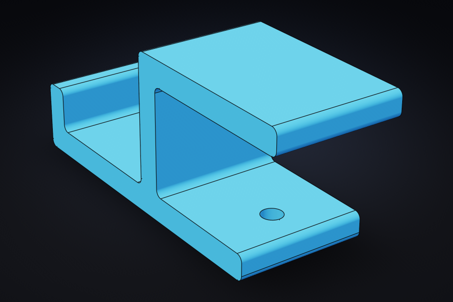
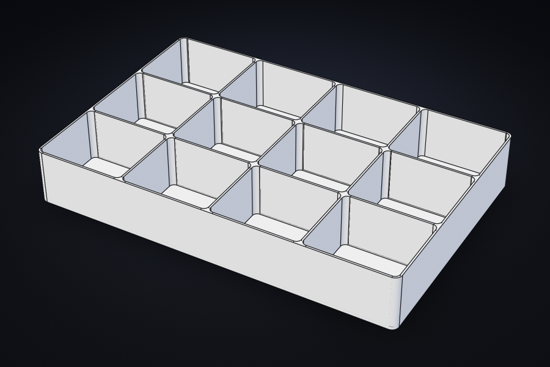
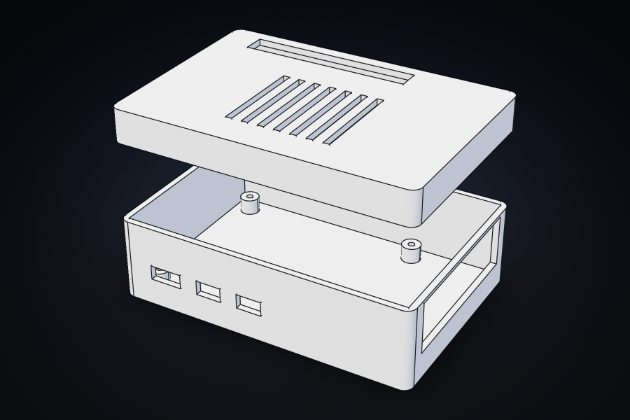
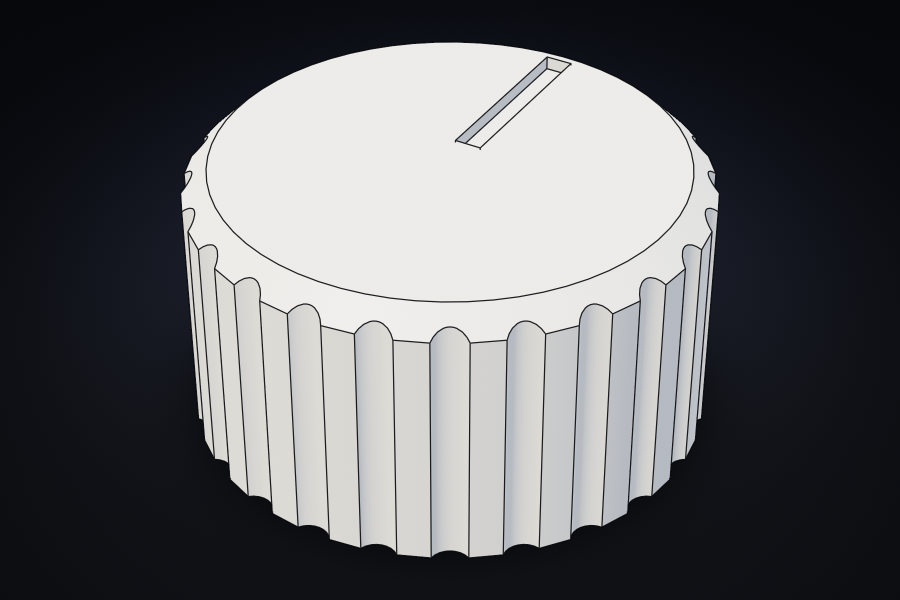
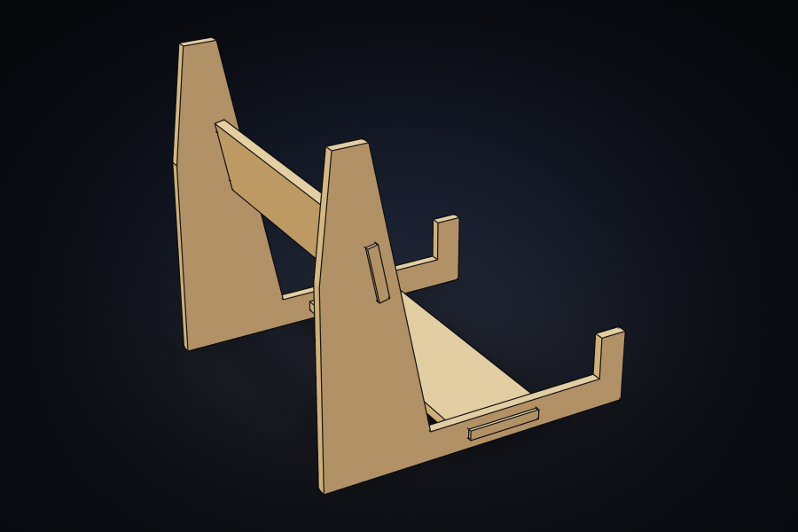

# Dogfooding the MCP server

To see what designing with tscad is like for an AI agent, five models were designed from
plain-English briefs. The designer acted purely as an MCP client: every step was a JSON-RPC
`tools/call` through `runMcpServer` over in-memory streams, using only `tscad_docs`,
`tscad_evaluate`, `tscad_render`, `tscad_check`, `tscad_pick_selectors` and `tscad_export`,
with no reading of `src/`. This page summarises each session and lists every point of
friction, with what was fixed and what still needs work.

The models are in [`examples/agent/`](../examples/agent).

## The sessions

### 1. Desk headphone hook

> *"a desk headphone hook that clamps to a 25 mm desk edge"*

1. `tscad_docs` read the guide, then the exact props of `extrude`, `polygon` and `fillet`.
2. Designed the side profile as one `<polygon>`: a C clamp over the desk edge, plus an arm
   with a lip below it. Extruded it on `plane="XZ"` with `center`, filleted `"|Y"`, and cut an
   M6 `TapHole` through the lower jaw for a clamp screw.
3. `tscad_evaluate` succeeded first time: 27.9 cm³, 35 g of PETG. `tscad_render` with
   `view: "front"` showed the profile.
4. `tscad_check` reported 1251 mm² of overhangs, most of it the underside of the top jaw.
   - **Friction:** it didn't say which way up to print it. I had to guess `buildDir` and
     re-run the check.
   - **Now:** the check adds "print it with buildDir [0, 0, -1] (upside down): overhangs drop
     to 0 mm²".
5. `tscad_export` wrote the STEP file (61 kB).

### 2. Drawer organiser

> *"a parametric drawer organiser for a 300×200 mm drawer"*

1. Built the outline with `roundedRect` and cut all the compartments in a single `<extrude>`:
   a grid of `roundedRect`s, mapped into one cut, which the guide recommends for speed.
   Evaluated in 1.6 s.
2. The full tray is 298 × 198 mm, too big for a 220 mm bed. A `piece` choice param cuts it into
   quarters with two nested `<split>`s.
   - **Friction:** `split`'s `plane` prop was typed `PlaneSpec`, which wasn't explained
     anywhere. I had to infer that `"XZ"` has its normal on +Y to pick `keep`.
   - **Now:** prop docs expand type names inline (`PlaneSpec = "XY" (normal +Z), …`).
3. `tscad_check` on `piece: "front-left"` passed, with a thinnest wall of 0.8 mm where the cut
   halved a divider. That's a design note rather than a tooling problem: cut between
   compartments.

### 3. Raspberry Pi 5 case

> *"a Raspberry Pi 5 case with vents and a GPIO slot"*

1. `tscad_docs` `topic: "parts"` listed `mountPatterns.raspberryPi4`.
   - **Friction:** it gave no numbers (hole spacing, board size, where the board sits relative
     to the holes) and didn't say whether the Pi 5 matches. I had to work out
     `outlineOffset + outline / 2` to centre the board.
   - **Now:** the parts docs include a table of every pattern (hole span, screw, outline,
     offset, pilot) and spell out the formula. There's also a `raspberryPi5` pattern.
2. Base: shell walls, port cut-outs, and `<BoltPattern>` of `<Standoff size="M2.5">`. Lid:
   vent slots from a `<linearPattern>` and a GPIO slot.
   - The first version put the base/lid split below the USB stack. Comparing the numbers in
     `tscad_evaluate` (bboxes) against the port heights caught it.
   - **Friction:** connector positions (USB-C, micro-HDMI, GPIO) aren't in the library, so I
     used published offsets from memory. See "Open" below.
3. `tscad_check` with `exploded: false` found no interference. The lid's 4556 mm² ceiling is an
   overhang, and the check now suggests printing it upside down.

### 4. Replacement knob for a 6 mm D-shaft

> *"a replacement knob for a 6 mm D-shaft"*

1. **Friction:** there are no 2D booleans. A D profile (a circle cut by a flat) and flutes
   around a rim can't be drawn as sketch loops, because loops only nest (holes) or union.
   - Workaround: in 3D, an `<intersection>` of a cylinder and a box for the D bore, and a
     `<polarPattern>` of 24 cylinder cuts for the flutes.
   - Cost: 4.4 s, the slowest of the five.
   - **Now:** the guide says so up front and shows this pattern. A real fix needs 2D booleans
     (see "Open").
2. `tscad_render` with `view: "bottom"` confirmed the D bore.
3. `tscad_check` flagged 0.76 mm next to the pointer groove.
   - **Friction:** it printed "0 % of the surface is thinner than 0.8 mm", which reads like a
     contradiction.
   - **Now:** it prints "< 0.1 %".

### 5. Laser-cut phone stand

> *"a laser-cut phone stand"*

1. Two side profiles, each with two mortises, plus a shelf and a back rest whose tenons pass
   through the mortises. Each shape is a component. `<drawing layer="cut">` wraps it in
   `<offset distance={kerf / 2} round={false}>` for the cutting file. `<part>`s extrude the
   same components for an assembled preview.
2. `tscad_check` found two interferences of 27 mm³ each, at y 42..43.5: the crossbars were
   off-centre by half a sheet. Fixed, and the check came back clean.
   - **Good:** the interference report, with volume and location, pointed straight at the bug.
3. `tscad_export` `format: "dxf"` wrote the file.
   - **Friction:** the result said "parts: left, right, shelf-3d, rest-3d", the 3D preview
     parts, when the DXF actually holds the four drawings.
   - **Now:** it says "drawings: side-left, side-right, shelf, rest".

### Probing common mistakes

Typical slips went through `tscad_evaluate` to see how the errors read:

| Mistake | Before | Now |
|---|---|---|
| `<cylinder rotate={90}>` | "rotate must be [x, y, z] numbers (got 90)", with no line | the hint `rotate={[0, 0, 90]}` or `rotateZ={90}`, and `at model.tsx:2:3` with a code frame |
| `<box size={[10, 10]}>` | "size must be [x, y, z]" | the hint "a box needs three sizes… for a 2D rectangle use `<rect>` inside `<extrude>`" |
| `<box center="xy">` | "center must be a boolean or [bx, by, bz]" | the hint `center={[true, true, false]}` |
| `<hole size="M3">` | "did you mean `<cone>`?" | `<Hole>` is in the parts library, with the `import { Hole } from "tscad/parts"` line |
| `<Hole>` without importing it | `ReferenceError: Hole is not defined` | the same, plus the hint `import { Hole } from "tscad/parts"` |
| `edges="top"` | the syntax error with the hint `edges.top()` / `">Z"` | (was already good) |
| `<fillet radius={8}>` on a 10 mm cube | **evaluates "ok"**, 962 mm³ | kernel bug, see "Open" |

## Friction list

**Fixed in this pass** (agent guide, docs generation, error hints, MCP tool outputs):

1. **The agent guide had gaps.**
   - Added sections: assemblies and mates (with an example), a pointer to constraint
     sketches, printing (orientation, teardrop holes) and common mistakes.
   - It now covers `<hull>`, `<drawing layer>`, the kerf idiom with `<offset>`, and the
     `<FingerJointBox>` / `<LivingHinge>` generators.
   - It says up front that there are no 2D booleans and shows the 3D workaround.
2. **The element index was one flat list,** starting with 20 constraint-sketch elements. It's
   now grouped into modelling, constraint sketch, and parts library (with the import line).
3. **Type names in prop docs weren't explained.** `PlaneSpec`, `CenterSpec`, `SelectorLike`,
   `MetricSize`, `MaterialName`, `HoleFit`, `MountPattern`, `Path3`, `Vec3` and `Axis` are now
   spelled out inline.
4. **The mount patterns had no numbers.** There's now a generated table and a `raspberryPi5`
   pattern.
5. **`tscad_check` didn't suggest an orientation.** It now tries the other five build
   directions and reports `betterOrientation` when one halves the overhang area or better.
6. **No selector isolated some faces and edges.** When `tscad_pick_selectors` has no
   geometric selector that picks the item alone, it now offers an `edges.within(...)` /
   `faces.within(...)` box around it, ahead of the fragile `index`.
7. **The `tscad_export` DXF/SVG result named the 3D parts.** It now names the drawings it
   wrote.
8. **Errors on an element the model component returns directly had no location.** That's
   because JavaScriptCore drops the component's frame on a tail call.
   - The message now includes the element, e.g. `(in <cylinder r={2} h={5} rotate={90}>)`.
   - The MCP server then finds it in the source and adds `at model.tsx:L:C` with a code frame.
9. **Fix-it hints** for `rotate={n}`, two-number box sizes and `center` strings.
10. **Unknown lowercase tags** that name a parts-library component now point to the import.
11. **`ReferenceError`s** for tscad and tscad/parts exports now say what to import.
12. **Percentages:** "< 0.1 %" instead of "0 %" for a small but non-zero thin area.

**Open: needs other owners.**

- **Sketch:** 2D booleans (`<sketchDifference>` / `<sketchUnion>` / `<sketchIntersection>`)
  would make D profiles, fluted rims and keyholes one cheap extrude instead of 3D boolean cuts.
- **Kernel:**
  - `<fillet radius={8}>` on a 10 mm cube returns `ok` (962 mm³) instead of refusing a radius
    larger than the faces allow.
  - 24 small cylinder cuts take about 4 s.
- **Parts, as a backlog:** board models with connector frames (Raspberry Pi 4/5 USB-C,
  micro-HDMI, USB/Ethernet, GPIO; Arduino USB-B and barrel jack) as anchors, so cases can cut
  ports from data instead of from memory.
- **Bun upstream:** JSX `source` information (`jsxDEV` gets `undefined`) would give every
  element an exact location, including ones returned directly by a component.
- **Render:** the default light background with white or natural PLA is low-contrast. Agents
  may want `background: "dark"`; worth considering as the default for `tscad_render`.

## Verdict

All five briefs became working, checked, exported models in 2–4 evaluate cycles each. The
biggest wins for an agent:

- errors that say how to fix them, at a line;
- a check that says which way up to print;
- interference reports with a location.

The tests in `tests/mcp.dogfood.test.ts` keep these fixes from regressing.
